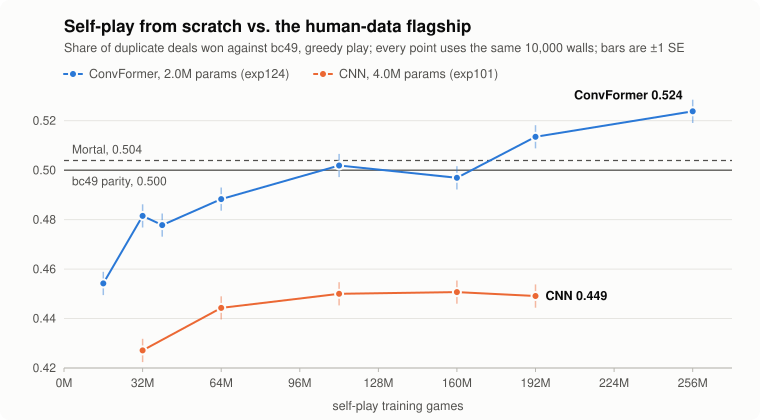

# LLM Mahjong

**Riichi mahjong agents that learn the game from scratch by self-play.**
A 2.0M-parameter network, trained on zero human games and zero external models, now wins more duplicate deals
than our human-data flagship and plays in the same tier as [Mortal](https://github.com/Equim-chan/Mortal).

English | [中文](README.zh.md)

<picture>
  <source media="(prefers-color-scheme: dark)" srcset="docs/assets/scaling_curve_dark.svg">
  
</picture>

[Highlights](#highlights) · [Results](#results-at-a-glance) · [Status](#current-status-2026-11-12) ·
[Quick start](#quick-start) · [Repository layout](#repository-layout) · [Evaluation](#evaluation) ·
[Live play](#live-play-on-majsoul-windows-client-machine) · [Documentation](#documentation)

> The name is historical: the project started as an LLM experiment (Phase 1, archived) and moved to small
> purpose-built networks in August 2026. See [Project history](#project-history).

## Highlights

- **Self-play RL from scratch has passed the behaviour-cloning level.** A ConvFormer trained only against
  itself (exp124) wins **0.5113 ± 0.0032** of duplicate deals against bc49, our human-data flagship, after
  192M games, the first significant lead for the pure lineage. The 256M checkpoint reads **0.5230 ± 0.0033**
  and is now a deployment champion alongside bc49; the run continues to 384M.
- **Model class moved the plateau; size and scale did not.** The CNN line flattens near 0.45 from 112M games
  on. Swapping only the trunk is worth **+5.00 ± 0.45 pp** at 32M games (2×2 ablation, exp127). A 5.7× larger
  trunk of the same class adds +0.41 ± 0.60 pp at 64M (exp125).
- **Defence emerges without being taught.** On the placebo-matched folding probe the self-play ConvFormer
  is level with bc49 at 144M games (0.171 vs 0.165); the CNN reaches 0.066 after 392M. At a four-way hanchan
  table with Mortal, bc49 and a CNN, the 192M checkpoint has the lowest deal-in rate (0.116).
- **The human-prior flagship ties Mortal.** bc49 is pure behaviour cloning on 18.5k Tenhou Houou games with
  2.00M parameters; over 1,200 hanchan against Mortal the result is 0.477 ± 0.014 (−0.36 ± 0.42 pt), a tie.
- **A fast, verified engine.** The Rust engine (`rust/riichi_rs`) is bit-identical with the Python reference
  and cut the cost of a million self-play games from $3.1 to $0.07.
- **Every run is preregistered.** More than 130 numbered experiments, each with its hypothesis and success
  criteria written before launch; closed levers stay in the ledger with the scope they were tested in.

## Results at a glance

**Single deals, duplicate 2v2 against bc49, all seats greedy (T=0).** Share is the fraction of walls won
(1 / 0.5 / 0); bc49 is the reference at 0.500.

| Model | Training signal | Params | Self-play games | Share vs bc49 | Walls |
|---|---|---|---|---|---|
| **exp124 ConvFormer @ 256M** (deployment champion, pure lineage; interim read) | self-play only | 2.0M | 256M | **0.5230 ± 0.0033** | 20,000 |
| **exp124 ConvFormer @ 192M** | self-play only | 2.0M | 192M | **0.5113 ± 0.0032** | 20,500 |
| Mortal 298k | external reference | ≈10.8M | — | 0.5039 ± 0.0041 | 10,500 |
| **bc49** (deployment champion, human-prior lineage) | BC on 18.5k human games | 2.0M | — | 0.500 (reference) | — |
| akochan (default tactics) | external reference | — | — | 0.4680 ± 0.0105 | 2,000 |
| exp101 CNN @ 192M | self-play only | 4.0M | 192M | 0.4493 ± 0.0046 | 10,500 |
| Rule-based agent | — | — | — | 0.3242 | 10,500 |
| exp27-A CNN @ 1M (August pure-lineage champion) | self-play only | — | 1M | 0.3181 | 10,500 |
| Random legal play | — | — | — | 0.0111 | 10,500 |

- 256M against 192M on the same 20,000 walls: **+1.09 ± 0.43 pp**. The preregistered verdict point is 384M.
- 192M against Mortal on 20,000 shared walls: +0.75 ± 0.43 pp. Same tier; not claimed as a lead.
- The figure above reads every checkpoint on one common set of 10,000 walls (SE ≈ 0.005 per point), so its
  192M and 256M points differ slightly from the 20k-wall verdict numbers in the table.

**Full hanchan, four-way table** (400 walls × 4 seat rotations, all greedy, uma per game):
Mortal +2,534 · exp124 @ 192M +2,039 · bc49 +726 · exp113-C CNN −5,299.
exp124 against Mortal: −495 ± 978, a tie.

Scope of these numbers: one training seed, the exp124 recipe, T=0, the current engine. Sources:
[experiments/FINDINGS.md](experiments/FINDINGS.md), [experiments/INDEX.md](experiments/INDEX.md) and
[experiments/exp124_convformer_scale_prereg/EXPERIMENT.md](experiments/exp124_convformer_scale_prereg/EXPERIMENT.md).

## Two lineages

| | Pure lineage (the goal) | Human-prior lineage (the yardstick) |
|---|---|---|
| Training signal | Self-play from random initialisation. No human data and no external model, ever. | Behaviour cloning on Tenhou Houou logs, optionally followed by RL on the prior. |
| Role | Discover the whole skill stack unaided, AlphaZero-style. | Calibrate the scale and diagnose the pure line; bc49 is the reference every model is read against. |
| Current best | **exp124 ConvFormer @ 256M**, deployment champion (0.5230 vs bc49; 192M: 0.5113) | **bc49**, deployment champion of the BC line; ties Mortal |
| Rules of the lineage | Human- and teacher-derived models are yardsticks only and never enter the champion line or the opponent pool. Situational curricula and rule variants are out. Leagues of the model's own frozen snapshots and EMA self-anchors count as pure. | Path so far: Houou BC (bc49) → RL on the prior (exp46) → hanchan placement training (exp55-D). RL on the prior ties bc49 and does not beat it. |

## Current status (2026-11-12)

**Deployment champions: exp124 @ 256M and bc49.** One per lineage, on the same 2.0M-parameter architecture
(ConvFormer × v3r encoder × 46-slot action head), both always played greedy (T=0).

- **exp124 ConvFormer @ 256M** (pure lineage, self-play RL only) is the strongest model in our evaluation.
  Head-to-head against bc49 on 20,000 duplicate walls it wins 0.5230 ± 0.0033 of the deals, 7 standard errors
  above parity. It is listed in place of the 192M checkpoint (0.5113 ± 0.0032) because it reads
  +1.09 ± 0.43 pp higher on the same walls. Checkpoint: `experiments/exp124s2_S2/games_256000000.pt`
  (not in git; GCS copy, how to run it and the training recipe are in
  [docs/champion_model.md](docs/champion_model.md)).
- **bc49** (human-prior lineage; pure BC on 18.5k Tenhou Houou games, holdout accuracy 0.806) is the BC
  champion and the reference every other model is read against. On the hanchan all-greedy ladder (the
  cleanest scale; 13 anchors, 200 duplicate pairs each): Mortal 298k 1465 ± 12, exp46-I 1457 ± 11,
  **bc49 1443 ± 11**; head-to-head with Mortal over 1,200 hanchan 0.477 ± 0.014, a tie. Majsoul maka grade S+
  twice. Configuration and checkpoint paths: [docs/champion_model.md](docs/champion_model.md); numbers:
  [experiments/LEADERBOARD.md](experiments/LEADERBOARD.md).

**RL has passed the BC level in our evaluation.** On duplicate single deals at T=0 the self-play model beats
the behaviour-cloned flagship at both 192M games (20,500 walls, 3.5 standard errors above parity) and 256M
games (20,000 walls, 7 standard errors). At the four-way hanchan table with Mortal the 192M checkpoint also
finishes above bc49 (+2,039 against +726 uma per game). It is the first RL model in this project to read
significantly above bc49: RL on top of the BC prior (exp46) only tied it. Scope: one training seed, our
duplicate protocol and engine; the pairwise hanchan verdict (≥ 1,200 games) has not been run on these
checkpoints.

**Pure lineage: exp124 ConvFormer.** The same 2.0M architecture as bc49, trained from scratch by synchronous
PPO self-play (≈$121 of rented single-GPU time to 192M games). Milestones against bc49, single deals, T=0:

| Games | 32M | 64M | 112M | 160M | 192M | 256M |
|---|---|---|---|---|---|---|
| ConvFormer (exp124) | 0.4815 | 0.4883 | 0.5019 | 0.4969 | 0.5135 | 0.5238 |
| CNN (exp101) | 0.4271 | 0.4443 | 0.4500 | 0.4507 | 0.4491 | — |

(Each cell is the same 10,000 walls, ± 0.0047.) Equivalence tests on fresh walls put the 112M and 133M
checkpoints within ±1 pp of bc49; 192M is the first to read significantly above it. Stage 2 is extending the run from 192M to 384M
with judgment points at 320M and 384M; it stood at ≈298M games on 2026-11-12.

The program's single-deal target (share ≥ 0.50 against bc49 on ≥ 20k walls) is met. The four-way table
above is the current hanchan reading.

What the pure line still lacks: yakuman are 0.6× as frequent as in human play, and Kokushi has never appeared
at any checkpoint. Probes show no Kokushi intent at all, an exploration gap rather than a perception gap.

<details>
<summary><b>What was tried on the way (exp59–exp133)</b></summary>

**On the CNN line (exp70–exp102, the $200 program).** Scaling was log-linear at ≈ +1.5–2 pp per doubling and
flattened at 0.45–0.46; the best CNN reading was exp101 p2 @ 400M, 0.4627 ± 0.0035. Every lever below was
preregistered and judged on 20k-pair T=0 finals, and every verdict holds only for that architecture and scale:

- **Closed levers:** hanchan / placement objectives (exp70/83/84/91), value methods ×4 (exp59/60/71/96),
  PBRS (exp73/74), counterfactual-rollout advantages (exp72), PSRO best response (exp87), QRE / KL magnet
  (exp88), style-conditioned population (exp89), global and shanten-weighted deal-in penalties with anneals
  (exp85/90/95; defence relaxes back when the penalty is removed), ensembles (exp92), run-time adaptation
  (exp93), oracle guiding and wait-prediction auxiliary heads (exp68/69), same-lineage opponent pools (exp82),
  inference-time search (exp86, exp100), parameter-space noise (exp97), greedy continuation with one-step
  deviations (exp98), learned-hazard safe-set macros (exp99), 2× capacity (exp101).
- **Small real lever:** end-of-training entropy anneal, +0.68 ± 0.28 pp, offence only (exp102).
- **Diagnosis (exp94 counterfactual takeover probe):** the gap to bc49 was one skill, the multi-step
  continuation when far from tenpai against a riichi. bc49 taking over from the exposure decision is worth
  +258 ± 94 points per decision, all from deal-in 16.5% → 11.5% with win rate unchanged; every single-step
  change is ≈ 0. A policy gradient sees one-step quantities only, so that chain was not climbable on the CNN.

**After the model-class change (exp124–exp133).**

- **exp124:** ConvFormer from scratch, +6.25 ± 0.62 pp over the CNN at 192M games (H1).
- **exp125:** 11.4M-parameter trunk of the same class, +0.41 ± 0.60 pp at 64M (H0).
- **exp126:** streaming rollouts with per-step policy refresh, +1.96 pp at 16M from scratch; the gain is gone
  in the 160M → 192M continuation (exp127 B, +0.17 ± 0.43 pp, with 26% more throughput).
- **exp127:** trunk main effect +5.00 ± 0.45 pp, action head +0.39 ± 0.43 pp.
- **exp129:** concept probes. Conditional riichi needs the ConvFormer trunk; the CNN never learns it by 392M.
- **exp132 / exp133:** oracle guiding (−1.28 ± 0.61 pp) and a leave-one-out baseline inside the GAE delta
  (+0.31 ± 0.61 pp) at 32M, both H0.

</details>

## Quick start

```bash
conda activate rlhf_mahjong
python -m pytest tests -q                              # engine parity, encoders, trainers, Rust ↔ Python
# build the Rust engine (after any change under rust/riichi_rs)
cd rust/riichi_rs && maturin build --release -i "$(which python)" && pip install --force-reinstall target/wheels/riichi_rs-*.whl && cd -
# serve the champion (bc49, greedy) for the Majsoul bridge — full manual in docs/champion_model.md
PYTHONPATH=. python scripts/serve_mjai_bot.py --ckpt experiments/_anchors_epoch6/bc49.pt --temperature 0
# pure-line PPO smoke on the Rust engine (long runs go to the cloud — see SKILLS.md for the RunPod runbook)
python scripts/train_dnn_ppo.py --engine rust --arch cnn_m_v3r --total_games 200000 --games_per_iter 2048 \
  --dup_k 8 --games_per_worker 1024 --workers 1 --exp_dir experiments/my_run_$(date +%Y%m%d_%H%M%S)
# T=0 paired evaluation of a checkpoint against bc49 (single deal / hanchan)
python -c "from scripts.run_elo_league import play_pair_vector as p; sc,_,_=p('CAND.pt','experiments/_anchors_epoch6/bc49.pt',4000,67000000,20,'cuda',temp_a=0.0,temp_b=0.0,hanchan=False); print(sum(sc)/len(sc))"
conda run -n rlhf_mahjong python tools/webui/server.py --port 8642   # inspector
```

Weights are not in git. The champion card explains where both champion checkpoints live, how to reproduce bc49
from public Tenhou logs in about 3.5 hours on one RTX 4080, and the three-stage self-play recipe behind
exp124. Inference needs only `torch`, `numpy` and `mahjong`, and runs on a CPU at ≈4.6 ms per decision. The
original exp124 launch command is in the Config section of its
[preregistration](experiments/exp124_convformer_scale_prereg/EXPERIMENT.md).

Every run needs an `EXPERIMENT.md` (purpose / method / success criteria) *before* launch, a heartbeat monitor and
TensorBoard mirror once launched, and a row in `experiments/INDEX.md` when it ends — see CLAUDE.md.

## Repository layout

```
src/tasks/mahjong/
├── table.py            # 136-tile deal engine; epoch-4 rules = Majsoul single-deal (red fives, abortive draws,
│                       #   double yakuman, nagashi mangan, kan-dora timing, kokushi ankan-chankan, chankan furiten)
│                       #   + round-context randomisation; reward = start-point delta (+ placement bonus)
├── claims.py           # call-window arbitration (ron > pon/kan > chi, double/triple ron)
├── hanchan.py          # full hanchan: renchan / honba / nagashi / uma — the verdict scale
├── arena.py            # duplicate-wall arena (A−B symmetric pairing)
└── shanten.py          # shanten / acceptance / dora mapping
rust/riichi_rs/         # Rust port of the engine + encoders + VecEnv (vectorised self-play, hanchan, league seat
│                       #   routing, per-seat reward styles, genbutsu masks); bit-exact with the Python engine
src/agents/dnn/
├── encoder.py          # observation encodings v1/v1r/v3/v3r(+red)/v3s/v4; 374-slot and 46-slot action spaces
├── arch_zoo.py         # cnn_m_r / cnn_m_v3r (CNN pure line) / convformer_m_v3r_m46 (bc49, exp124) / ensembles /
│                       #   AnchoredQPolicy (prior-anchored Q head, exp96) / handset / HandRiverFormer / vit
├── net.py              # base net + load_compatible (cross action-space / variant checkpoint loading)
├── selfplay.py         # Python-engine self-play (play_game / generator play_game_gen) — probes and bc49 tables
├── rust_rollout.py     # Rust-engine rollout (collect_rust): league seats, reward styles, uint8 planes
├── parallel_rollout.py # multi-process Python rollout + GPU batch inference (infer_server.py)
├── checkpoint.py       # load_dnn: the one checkpoint -> policy loader (arena, probes, bridge, league opponents)
├── style_stats.py      # capability metrics (win / deal-in / riichi / call rates, turns) for TB and evals
└── mjai_bridge.py      # Majsoul live bridge (MJAI shadow table; encoder + legal actions reused unchanged)
src/eval/
├── vec_arena.py        # vectorised GPU arena: play_pair_vector (2v2 duplicate, single deal / hanchan) + the
│                       #   collect_parallel config shared with the four-entity table driver
├── arena.py            # rating v2 four-entity rotated table (play_table) writing ledger rows
├── probe_loop.py       # Python-engine self-play loop with per-turn hooks (probe_defense / probe_riichi)
└── ledger / registry / fits / schedule / importers / fingerprints   # rating system v2 (scripts/rating.py)
scripts/
├── train_dnn_ppo.py    # PPO trainer: --engine rust, dup_k=8 duplicate-wall group baseline, GAE, entropy
│                       #   schedules / target-entropy dual control, KL anchors, league pools, PBRS shaping,
│                       #   deal-in penalties (global / shanten-weighted / annealed), counterfactual advantages
├── train_human_bc.py   # behaviour cloning on Tenhou logs (bc49 recipe)
├── train_dnn_bc.py / arch_sweep_bc.py   # BC on the heuristic teacher (generate_sft_data.py) — the bc_cnn Elo origin
├── train_dnn_dqn.py / train_dnn_qstitch.py   # value-method line (Double DQN on a prior; prior-anchored Q-stitch)
├── run_elo_league.py   # anchor pool Elo (single-deal and --hanchan, engine-fingerprint guard); stable entry
│                       #   play_pair_vector(...) wraps src/eval/vec_arena
├── run_arena_dnn.py    # batch-1 Python-engine arena (rule-override diagnostics); stable entry load_dnn(path, device)
├── rating.py           # rating system v2 (append-only ledger, four-entity tables, pt board) — epoch 7 pending
├── probe_*.py / eval_style_profile.py         # probe family: defence IQ, decomposition, conditional entropy, style
├── serve_mjai_bot.py   # HTTP agent service for the Majsoul bridge
└── phase2_dnn/         # cloud launch scripts (GCP G4 flex; RunPod runbooks live in SKILLS.md)
tools/webui/            # inspector: training curves, self-play viewer (per-step probabilities / V), replay
tools/majsoul_bridge/   # MahjongCopilot plugin (live play = champion greedy; one of the three human yardsticks)
```

**Infrastructure.** Training runs on RunPod (Secure Cloud whenever champion weights are on the pod). The local
RTX 4080 is for smoke tests, probes and evaluation only.

## Evaluation

Three scales, never mixed in one table (see the notes at the top of
[experiments/LEADERBOARD.md](experiments/LEADERBOARD.md)):

1. **Anchor-pool Elo** (`experiments/elo_league/`): 13 anchors, sign-MLE, `bc_cnn` pinned at 1000. Engine changes
   invalidate history (engine-fingerprint guard; a new epoch = full recalibration). Anchors play under the
   temperature they were calibrated at (stored in the pool file).
2. **Hanchan scale** (`hanchan.py`, own anchor pool under `experiments/elo_league/hanchan/`): the verdict scale.
   Vectorised GPU evaluation ≈ 967 hanchan/min; Mortal is rated with `rate_mortal_hanchan.py`.
3. **Probes and human yardsticks**: defence IQ, style profile (human reference: agari .212 / houjuu .125 /
   riichi .182 / call .338), counterfactual takeover probes (exp94), Majsoul maka grades.

**Verdict protocol** (CLAUDE.md): candidates at T=0, out-of-family ladders, hanchan n ≥ 300 for finals; single-deal
finals are 20k paired walls in two seed segments (SE ≈ 0.0035); in-family T=1 curves never decide anything on their
own. Probes that take several decisions per deal report **deal-clustered** standard errors (per-decision SEs
understate by ≈ 2×). A champion changes only on a significantly positive T=0 head-to-head; ladder scores rank, they
do not crown. Every verdict carries a scope stamp (architecture, signal source, scale, evaluation protocol)
and holds only inside it.

## Live play on Majsoul (Windows client machine)

The human yardsticks (maka grade, placements, deal-in rate) can only be read from real games. Standard topology is
two machines — the model machine runs this repo and the checkpoint, the client machine (Windows) runs
[MahjongCopilot](https://github.com/latorc/MahjongCopilot) (MC) + Chrome — joined by an SSH tunnel. A single-machine
setup works too.

```
client Windows 11: MC + plugin ── mitmproxy:10999 ──► Chrome (Majsoul)
                      └─ bot_llmmahjong ──► 127.0.0.1:8765 ──ssh -L tunnel──► model machine: serve_mjai_bot.py
```

1. **Model machine** (Linux, repo root): start the agent service with the champion, greedy:
   ```bash
   PYTHONPATH=. python scripts/serve_mjai_bot.py --ckpt experiments/_anchors_epoch6/bc49.pt \
     --temperature 0 --log experiments/exp24_majsoul_live_$(date +%Y%m%d_%H%M%S)/mjai_session.jsonl
   ```
   `curl localhost:8765/health` returns ok when ready. The service has **no auth and listens on 127.0.0.1 only**;
   never expose it.
2. **Install MC on the client** (PowerShell; do not use an old conda on that machine):
   ```powershell
   winget install Python.Python.3.12 --scope user
   git clone https://github.com/latorc/MahjongCopilot $env:USERPROFILE\MahjongCopilot
   cd $env:USERPROFILE\MahjongCopilot; python -m venv venv; .\venv\Scripts\pip install -r requirements.txt; .\venv\Scripts\playwright install chromium
   ```
3. **Apply the three Windows patches and install our bot plugin** (patches verified against MC `31be3de`):
   ```powershell
   git apply <this repo>\tools\majsoul_bridge\mahjongcopilot_windows.patch
   python <this repo>\tools\majsoul_bridge\install.py $env:USERPROFILE\MahjongCopilot
   ```
   The patches fix the three Windows blockers: Playwright's bundled Chromium SxS error (use system Chrome), the
   46 MB Majsoul wasm buffered by mitmproxy (stream large responses), and the mitm root certificate needing admin
   (install into the current-user store).
4. **Tunnel** (client, keep open): `ssh -N -L 8765:127.0.0.1:8765 <model machine>`; MC's URL stays
   `http://127.0.0.1:8765`.
5. **Configure and start MC**: in `settings.json` set `"model_type": "LLM_Mahjong"`,
   `"llmmahjong_url": "http://127.0.0.1:8765"`, `"ai_randomize_choice": 0`; `enable_automation` = `false` for
   assist mode (you click; the panel shows probabilities / V) or `true` for auto-play (official scoring).
   Start: `cd $env:USERPROFILE\MahjongCopilot; .\venv\Scripts\python.exe main.py` → launch browser → log in.
6. **Verify and score**: play one friendly-room game first; every `Bot in: tsumo` in the MC log must have a
   `Bot out: dahai` and `no op list` must be 0. Afterwards, on the model machine:
   `python scripts/analyze_majsoul_session.py <session>.jsonl` (placements / wins / deal-ins / riichi / calls).

**Detailed runbooks**: [tools/majsoul_bridge/README.md](tools/majsoul_bridge/README.md) (general flow, both modes,
session log format, protocol pitfalls) · [tools/majsoul_bridge/WINDOWS.md](tools/majsoul_bridge/WINDOWS.md)
(Windows field notes: symptoms and root causes of the three patches, new Unity client compatibility,
`spawn UNKNOWN` / black screen / certificate troubleshooting) · [docs/champion_model.md](docs/champion_model.md)
(which checkpoint, how much hardware).

> **Risk**: third-party automation violates Majsoul's terms of service and **can get the account banned**. Use only
> accounts you can afford to lose.

## Documentation

| If you want to… | Read |
|---|---|
| Work in this repo (rules and project map) | [CLAUDE.md](CLAUDE.md) |
| Avoid known pitfalls (lessons, hardware, ops incidents) | [SKILLS.md](SKILLS.md) |
| Run the strongest model (model card, four ways to run it, resources, version history) | [docs/champion_model.md](docs/champion_model.md) |
| See the current standings on each scale | [experiments/LEADERBOARD.md](experiments/LEADERBOARD.md) |
| Look up a run (one line each) | [experiments/INDEX.md](experiments/INDEX.md) |
| Read results with their scope stamps | [experiments/FINDINGS.md](experiments/FINDINGS.md) |
| See what is queued | [TASKS.md](TASKS.md) |
| Read the pure-line program and its verdicts | [experiments/designs/design_pure_line_200usd_program.md](experiments/designs/design_pure_line_200usd_program.md) |
| Check known engine deviations | [docs/engine_known_issues.md](docs/engine_known_issues.md) |

## Project history

- **Phase 1 (2026-05 → 08-14, archived)**: LLM (Qwen + LoRA) + text rollouts + PBRS/PPO. All arena results null,
  returns not decodable from hidden states → retired. Legacy: the engine, the reward registry, the arena protocol,
  the GCP workflow. Records: `experiments/reports/report_exp1..exp5`. The LLM trainer, its GCP/Vertex launchers and
  the LLM probes were deleted on 2026-11-01 (git history before `6907cf8` has them); what remains of Phase 1 in the
  tree is the text rollout stack (`src/tasks/mahjong/{orchestrator,batch_rollout,prompts}.py`,
  `src/core/{chat_format,rollout}.py`) because `arena.py` / `claims.py` sit in the Elo engine fingerprint and the
  engine tests drive it, plus the reward registry (`rewards.py`) and the heuristic teacher (`generate_sft_data.py`).
- **Phase 2 (current)**: small dedicated networks (2–23M params) + tensor encodings + self-play PPO / BC / DQN.
  - 2026-08-27: bc49 crowned; the human-prior lineage ties Mortal on the hanchan scale.
  - 2026-09-06 → 10-02: the $200 pure-line program on CNNs; scaling plateaus near 0.46 against bc49.
  - 2026-10-31 → now: the model-class change (exp124). The pure line reaches bc49 at 112–133M games and passes
    it at 192M.
  - 2026-11-12: exp124 @ 256M becomes a deployment champion alongside bc49.

## Third-party components and terms

- **Mortal** is an external yardstick. Its weights (`data/mortal_ext/`) are not part of this repo and must not
  be redistributed.
- **akochan** ([critter-mj/akochan](https://github.com/critter-mj/akochan)) is used unmodified as a reference
  opponent, for non-commercial research only.
- **MahjongCopilot** is patched and driven by `tools/majsoul_bridge/` for live play.
- Human game logs come from Tenhou's Houou tables and are not redistributed here.

**Discipline** (enforced by CLAUDE.md): pre-register every run; check throughput after launch; heartbeat on every
long job; terminate cloud machines when done (never merely stop them); reward logic goes through the registry; new
lessons are appended to SKILLS.md with a date.
