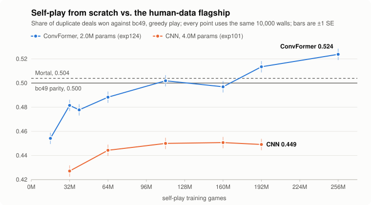

# LLM Mahjong

**靠自对弈从零学会日本麻将的智能体。**
一个 2.0M 参数的网络，不用任何人类牌谱、不用任何外部模型，现在在复式单局上赢过我们的人类数据旗舰，
与 [Mortal](https://github.com/Equim-chan/Mortal) 同档。

[English](README.md) | 中文

> 英文版 [README.md](README.md) 是权威版本；本文为其中文对照。

<picture>
  <source media="(prefers-color-scheme: dark)" srcset="docs/assets/scaling_curve_dark.svg">
  
</picture>

[亮点](#亮点) · [结果一览](#结果一览) · [当前状态](#当前状态2026-11-12) · [快速开始](#快速开始) ·
[仓库结构](#仓库结构) · [评估体系](#评估体系) · [雀魂实战](#雀魂实战测试windows-打牌机) · [文档导航](#文档导航)

> 项目名是历史遗留：最初是 LLM 实验（Phase 1，已归档），2026 年 8 月转向小型专用网络。见[项目历程](#项目历程)。

## 亮点

- **从零自对弈追上并超过人类数据旗舰。** 只和自己对打训练出来的 ConvFormer（exp124）在 192M 局时对 bc49 的复式单局份额为
  **0.5113 ± 0.0032**，是纯血谱系第一次显著领先。256M 检查点读数 **0.5230 ± 0.0033**，训练继续跑到 384M。
- **挪动平台的是模型类，不是参数量和规模。** CNN 线从 112M 局起停在 0.45 附近。只换主干，32M 局时值 **+5.00 ± 0.45 pp**
  （2×2 消融，exp127）；同类主干放大 5.7×，64M 局时只多 +0.41 ± 0.60 pp（exp125）。
- **防守是自己长出来的。** 在配对安慰剂的弃和探针上，自对弈 ConvFormer 在 144M 局时与 bc49 持平（0.171 对 0.165），
  CNN 到 392M 局才 0.066。与 Mortal、bc49、CNN 同桌打半庄时，192M 检查点的放铳率是四家里最低的（0.116）。
- **人类先验旗舰打平 Mortal。** bc49 是在 1.85 万局天凤凤凰卓牌谱上做的纯行为克隆，2.00M 参数；对 Mortal 1,200 场半庄
  0.477 ± 0.014（−0.36 ± 0.42 pt），打平。
- **快而且验证过的引擎。** Rust 引擎（`rust/riichi_rs`）与 Python 参考实现位级一致，每百万局自对弈成本从 $3.1 降到 $0.07。
- **每个 run 都预注册。** 130 多个编号实验，假设和成功标准都在发射前写好；判负的杠杆连同它的检验范围一起留在台账里。

## 结果一览

**单局，对 bc49 的 2v2 复式，全员贪心（T=0）。** 份额 = 每副牌山的胜负（1 / 0.5 / 0）取平均；bc49 为参照 0.500。

| 模型 | 训练信号 | 参数 | 自对弈局数 | 对 bc49 份额 | 牌山数 |
|---|---|---|---|---|---|
| **exp124 ConvFormer @ 256M**（中期读数） | 纯自对弈 | 2.0M | 256M | **0.5230 ± 0.0033** | 20,000 |
| **exp124 ConvFormer @ 192M** | 纯自对弈 | 2.0M | 192M | **0.5113 ± 0.0032** | 20,500 |
| Mortal 298k | 外部参照 | ≈10.8M | — | 0.5039 ± 0.0041 | 10,500 |
| **bc49**（部署冠军） | 1.85 万局人类牌谱 BC | 2.0M | — | 0.500（参照） | — |
| akochan（默认 tactics） | 外部参照 | — | — | 0.4680 ± 0.0105 | 2,000 |
| exp101 CNN @ 192M | 纯自对弈 | 4.0M | 192M | 0.4493 ± 0.0046 | 10,500 |
| 规则 agent | — | — | — | 0.3242 | 10,500 |
| exp27-A CNN @ 1M（8 月的纯血谱系冠军） | 纯自对弈 | — | 1M | 0.3181 | 10,500 |
| 随机合法打 | — | — | — | 0.0111 | 10,500 |

- 256M 对 192M，同 20,000 副牌山配对：**+1.09 ± 0.43 pp**。预注册的判决点在 384M。
- 192M 对 Mortal，20,000 副共同牌山：+0.75 ± 0.43 pp。同档，不写作领先。
- 上图每个检查点都读在同一组 10,000 副牌山上（每点 SE ≈ 0.005），所以图上 192M、256M 两点与表里 2 万牌山的判决数字略有出入。

**完整半庄，四方同桌**（400 副牌山 × 4 种座位轮换，全员贪心，每场 uma）：
Mortal +2,534 · exp124 @ 192M +2,039 · bc49 +726 · exp113-C CNN −5,299。exp124 对 Mortal：−495 ± 978，打平。

这些数字的范围：单个训练种子、exp124 配方、T=0、当前引擎。出处：
[experiments/FINDINGS.md](experiments/FINDINGS.md)、[experiments/INDEX.md](experiments/INDEX.md)、
[experiments/exp124_convformer_scale_prereg/EXPERIMENT.md](experiments/exp124_convformer_scale_prereg/EXPERIMENT.md)。

## 两条谱系

| | 纯血谱系（终极目标） | 人类先验谱系（标尺） |
|---|---|---|
| 训练信号 | 从随机初始化自对弈。永远不用人类数据，也不用外部模型。 | 天凤凤凰卓牌谱行为克隆，之后可选在先验上做 RL。 |
| 角色 | AlphaZero 式，自己发现整个技能栈。 | 校准刻度、诊断纯血线，并作为部署模型。 |
| 当前最强 | exp124 ConvFormer（192M：对 bc49 0.5113；256M 中期：0.5230） | **bc49**，部署冠军；与 Mortal 打平 |
| 谱系规则 | 人类 / 教师系模型只做标尺，永不进冠军谱系或对手池；情景课程与规则变体不做；自身冻结快照的联赛与 EMA 自锚算纯。 | 已走过的路径：凤凰卓 BC（bc49）→ 先验上做 RL（exp46）→ 半庄排位训练（exp55-D）。先验上的 RL 与 bc49 打平、未超过。 |

## 当前状态（2026-11-12）

**部署冠军 = bc49**（人类先验谱系；ConvFormer × v3r 编码 × 46 槽动作头，2.00M 参数，纯 BC，凤凰卓 18.5k 局，holdout 精度 0.806）。
实战与终审一律 T=0 贪心。半庄全贪心梯子（最干净的刻度，13 锚，每对 200 复式）：Mortal 298k 1465 ± 12、exp46-I 1457 ± 11、**bc49 1443 ± 11**；
对 Mortal 头对头 1,200 场 0.477 ± 0.014，打平。雀魂 maka 两轮 S+。
配置与 ckpt 路径见 [docs/champion_model.md](docs/champion_model.md)，数字见 [experiments/LEADERBOARD.md](experiments/LEADERBOARD.md)。

**纯血谱系 = exp124 ConvFormer。** 与 bc49 相同的 2.0M 架构，用同步 PPO 自对弈从零训练（到 192M 局租用单卡约 $121）。
对 bc49 的里程碑读数，单局、T=0：

| 局数 | 32M | 64M | 112M | 160M | 192M | 256M |
|---|---|---|---|---|---|---|
| ConvFormer（exp124） | 0.4815 | 0.4883 | 0.5019 | 0.4969 | 0.5135 | 0.5238 |
| CNN（exp101） | 0.4271 | 0.4443 | 0.4500 | 0.4507 | 0.4491 | — |

（每格都是同一组 10,000 副牌山，± 0.0047。）在新牌山上的等价检验把 112M 与 133M 检查点定在 bc49 的 ±1 pp 以内；
192M 是第一个显著高于它的读数。Stage 2 正把训练从 192M 延长到 384M，判决点在 320M 和 384M；2026-11-12 时进度约 298M 局。

计划书的单局目标（对 bc49 份额 ≥ 0.50，≥ 2 万牌山）已达成。两两半庄判决（≥ 1,200 场）还没在这些检查点上跑；
上面的四方同桌是目前的半庄读数。在 [docs/champion_model.md](docs/champion_model.md) 记下加冕用的头对头之前，部署模型仍是 bc49。

纯血线还缺的：役满频率是人类的 0.6×，国士无双在任何检查点都没出现过。探针显示它完全没有做国士的意图，
是探索上的缺口，不是感知上的缺口。

<details>
<summary><b>一路试过什么（exp59–exp133）</b></summary>

**CNN 线（exp70–exp102，$200 计划）。** 缩放是对数线性的，每倍增 ≈ +1.5–2 pp，在 0.45–0.46 走平；CNN 的最好读数是
exp101 p2 @ 400M，0.4627 ± 0.0035。下面每个杠杆都预注册、都用 20k 对 T=0 终评判决，每个判决只在那个架构和规模内有效：

- **已关闭的杠杆**：半庄 / 顺位目标（exp70/83/84/91）、价值方法 ×4（exp59/60/71/96）、PBRS（exp73/74）、
  反事实 rollout 优势（exp72）、PSRO 最佳响应（exp87）、QRE / KL 磁铁（exp88）、风格条件化人口（exp89）、
  全局与向听加权放铳惩罚 + 退火（exp85/90/95；惩罚一撤防守就弹回）、集成（exp92）、运行时适应（exp93）、
  oracle guiding 与待张辅助头（exp68/69）、同谱系对手池（exp82）、推理时搜索（exp86、exp100）、参数空间噪声（exp97）、
  贪心续打 + 单点偏离（exp98）、学到的危险度安全集宏（exp99）、2× 容量（exp101）。
- **真实但小的杠杆**：训练收尾的熵退火，+0.68 ± 0.28 pp，只补进攻端（exp102）。
- **诊断（exp94 反事实接管探针）**：与 bc49 的差距是一项技能，即远手面对立直时的多步续打。bc49 从暴露决策起接管值
  +258 ± 94 分 / 决策，全部来自放铳 16.5% → 11.5%、和牌率不变；任何单步改动都 ≈ 0。策略梯度只看得到单步量，
  所以这条链在 CNN 上爬不上去。

**换模型类之后（exp124–exp133）。**

- **exp124**：ConvFormer 从零，192M 局时比 CNN 高 +6.25 ± 0.62 pp（H1）。
- **exp125**：同类 11.4M 参数主干，64M 局时 +0.41 ± 0.60 pp（H0）。
- **exp126**：流式 rollout、每步刷新策略，从零 16M 局时 +1.96 pp；在 160M → 192M 续训里增益消失
  （exp127 B，+0.17 ± 0.43 pp，吞吐 +26%）。
- **exp127**：主干主效应 +5.00 ± 0.45 pp，动作头 +0.39 ± 0.43 pp。
- **exp129**：概念探针。条件立直需要 ConvFormer 主干；CNN 到 392M 局也没学会。
- **exp132 / exp133**：32M 局时的 oracle 引导（−1.28 ± 0.61 pp）与 GAE δ 内的留一基线（+0.31 ± 0.61 pp），均 H0。

</details>

## 快速开始

```bash
conda activate rlhf_mahjong
python -m pytest tests -q                              # 引擎一致性、编码器、训练器、Rust ↔ Python
# 构建 Rust 引擎（改动 rust/riichi_rs 后）
cd rust/riichi_rs && maturin build --release -i "$(which python)" && pip install --force-reinstall target/wheels/riichi_rs-*.whl && cd -
# 跑冠军（bc49，贪心）给雀魂桥接用——完整手册见 docs/champion_model.md
PYTHONPATH=. python scripts/serve_mjai_bot.py --ckpt experiments/_anchors_epoch6/bc49.pt --temperature 0
# 纯血线 PPO 冒烟（Rust 引擎；长训练一律上云——RunPod runbook 见 SKILLS.md）
python scripts/train_dnn_ppo.py --engine rust --arch cnn_m_v3r --total_games 200000 --games_per_iter 2048 \
  --dup_k 8 --games_per_worker 1024 --workers 1 --exp_dir experiments/my_run_$(date +%Y%m%d_%H%M%S)
# 某 ckpt 对 bc49 的 T=0 配对评测（单局 / 半庄）
python -c "from scripts.run_elo_league import play_pair_vector as p; sc,_,_=p('CAND.pt','experiments/_anchors_epoch6/bc49.pt',4000,67000000,20,'cuda',temp_a=0.0,temp_b=0.0,hanchan=False); print(sum(sc)/len(sc))"
conda run -n rlhf_mahjong python tools/webui/server.py --port 8642   # 检视台
```

权重不在 git 里。冠军模型卡写明了 bc49 检查点在哪里，以及怎样用公开的天凤牌谱在一张 RTX 4080 上约 3.5 小时复现。
推理只需要 `torch`、`numpy`、`mahjong`，CPU 上每个决策 ≈4.6 ms。exp124 的发射命令在它的
[预注册文件](experiments/exp124_convformer_scale_prereg/EXPERIMENT.md) Config 一节。

每个 run 发射**前**要有 `EXPERIMENT.md`（目的/方法/成功标准），发射后挂心跳与 TensorBoard 镜像，收尾在 `experiments/INDEX.md` 记一行——见 CLAUDE.md。

## 仓库结构

```
src/tasks/mahjong/
├── table.py            # 136 张牌桌引擎；纪元 4 规则 = 雀魂单局（赤宝牌/途中流局/双倍役满/流局满贯/
│                       #   明杠宝牌时机/国士抢暗杠/抢杠振听）+ 场因素随机化；奖励 = 起点差分（+ 顺位奖）
├── claims.py           # 响应窗口裁决（和 > 碰杠 > 吃，双响/三响）
├── hanchan.py          # 完整半庄：连庄/本场/流满/uma——裁决刻度
├── arena.py            # 复式牌竞技场（A−B 对称配对）
└── shanten.py          # 向听/受入/宝牌映射
rust/riichi_rs/         # 引擎 + 编码器 + VecEnv 的 Rust 移植（向量化自对弈、半庄、联赛席位路由、
│                       #   逐席奖励风格、现物掩码）；与 Python 引擎位级一致
src/agents/dnn/
├── encoder.py          # 观测编码 v1/v1r/v3/v3r(+赤)/v3s/v4；374 槽与 46 槽动作空间
├── arch_zoo.py         # cnn_m_r / cnn_m_v3r（CNN 纯血线）/ convformer_m_v3r_m46（bc49 与 exp124）/ 集成 /
│                       #   AnchoredQPolicy（先验锚定 Q 头，exp96）/ handset / HandRiverFormer / vit
├── net.py              # 基类 + load_compatible（跨动作空间/变体加载）
├── selfplay.py         # Python 引擎自对弈（play_game / 生成器 play_game_gen）——探针与 bc49 桌
├── rust_rollout.py     # Rust 引擎 rollout（collect_rust）：联赛席位、奖励风格、uint8 平面
├── parallel_rollout.py # 多进程 Python rollout + GPU 批推理（infer_server.py）
├── checkpoint.py       # load_dnn：唯一的 checkpoint → 策略网加载器（竞技场/探针/桥接/联赛对手共用）
├── style_stats.py      # 能力指标（和牌/放铳/立直/副露率、巡目）——TB 与评测共用
└── mjai_bridge.py      # 雀魂实战桥接（MJAI 影子桌；编码器与合法动作零改动复用）
src/eval/
├── vec_arena.py        # 向量化 GPU 竞技场：play_pair_vector（2v2 duplicate，单局/半庄）+ 与四实体同桌驱动共用的 collect_parallel 配置
├── arena.py            # 评分体系 v2 四实体轮转同桌（play_table），直接写账本行
├── probe_loop.py       # 带逐巡回调的 Python 引擎自对弈循环（probe_defense / probe_riichi 共用）
└── ledger / registry / fits / schedule / importers / fingerprints   # 评分体系 v2（scripts/rating.py）
scripts/
├── train_dnn_ppo.py    # PPO 训练器：--engine rust、dup_k=8 复式牌组基线、GAE、熵时间表/目标熵对偶控制、
│                       #   KL 锚、联赛池、PBRS 塑形、放铳惩罚（全局/向听加权/退火）、反事实优势
├── train_human_bc.py   # 天凤牌谱行为克隆（bc49 配方）
├── train_dnn_bc.py / arch_sweep_bc.py   # 对启发式教师（generate_sft_data.py）做 BC——Elo 原点锚 bc_cnn 的来源
├── train_dnn_dqn.py / train_dnn_qstitch.py   # 价值方法线（先验上 Double DQN；先验锚定 Q-stitch）
├── run_elo_league.py   # 锚池 Elo（单局与 --hanchan，引擎指纹守卫）；稳定入口 play_pair_vector(...) 包装 src/eval/vec_arena
├── run_arena_dnn.py    # Python 引擎 batch-1 竞技场（规则覆盖诊断）；稳定入口 load_dnn(path, device)
├── rating.py           # 评分体系 v2（只追加账本、四实体同桌、pt 主榜）——纪元 7 待开
├── probe_*.py / eval_style_profile.py         # 探针族：防守 IQ、牌效拆分、条件熵、风格
├── serve_mjai_bot.py   # 雀魂桥接用 HTTP 代理服务
└── phase2_dnn/         # 云发射脚本（GCP G4 flex；RunPod runbook 在 SKILLS.md）
tools/webui/            # 检视台：训练曲线、自对弈看板（逐步概率/V）、复盘
tools/majsoul_bridge/   # MahjongCopilot 插件（实战 = 冠军贪心；三把人类尺之一）
```

**基础设施**：训练在 RunPod（pod 上有冠军权重时一律 Secure Cloud）；本地 RTX 4080 只做冒烟、探针和评测。

## 评估体系

三个刻度不可混列（见 [experiments/LEADERBOARD.md](experiments/LEADERBOARD.md) 顶部说明）：

1. **锚池 Elo**（`experiments/elo_league/`）：13 锚点 sign-MLE，`bc_cnn` 钉 1000。引擎变更 ⇒ 历史作废、整池重校（引擎指纹守卫）。锚在自己被标定的温度下应战（写在池文件里）。
2. **半庄刻度**（`hanchan.py`，自己的锚池在 `experiments/elo_league/hanchan/`）：裁决刻度。向量化 GPU 评测 ≈967 场/分；Mortal 用 `rate_mortal_hanchan.py` 评分。
3. **探针与人类尺**：defense IQ、风格剖面（人类参照 agari .212 / houjuu .125 / riichi .182 / call .338）、反事实接管探针（exp94）、雀魂 maka 档位。

**评测协议**（CLAUDE.md）：终审一律候选 T=0 + 族外梯子 + 半庄 n ≥ 300；单局终评 = 不重叠种子段上 ≥ 20k 配对牌山（SE ≈ 0.0035）；T=1 族内曲线不得单独下结论。
每局取多个决策的探针必须报**按局聚类**的标准误（逐决策 SE 低估约 2×）。加冕只认双方 T=0 头对头显著为正，梯子分只排名不加冕。
每个判决都带范围戳（架构、信号源、规模、评测口径），只在戳内有效。

## 雀魂实战测试（Windows 打牌机）

人类刻度（maka 档位 / 顺位 / 放铳）只能在真实对局上读出来。标准拓扑是两台机——模型机跑本仓库与 checkpoint，打牌机（Windows）跑
[MahjongCopilot](https://github.com/latorc/MahjongCopilot)（MC）+ Chrome，用 SSH 隧道连起来；单机部署也可行。

```
打牌机 Windows 11: MC + 插件 ── mitmproxy:10999 ──► Chrome(雀魂)
                       └─ bot_llmmahjong ──► 127.0.0.1:8765 ──ssh -L 隧道──► 模型机: serve_mjai_bot.py
```

1. **模型机**（Linux，仓库根目录）启动 agent 服务，冠军 + 贪心：
   ```bash
   PYTHONPATH=. python scripts/serve_mjai_bot.py --ckpt experiments/_anchors_epoch6/bc49.pt \
     --temperature 0 --log experiments/exp24_majsoul_live_$(date +%Y%m%d_%H%M%S)/mjai_session.jsonl
   ```
   `curl localhost:8765/health` 返回 ok 即就绪。服务**无鉴权、只监听 127.0.0.1**，不要暴露到公网。
2. **打牌机装 MC**（PowerShell；不要用机器上的老 conda）：
   ```powershell
   winget install Python.Python.3.12 --scope user
   git clone https://github.com/latorc/MahjongCopilot $env:USERPROFILE\MahjongCopilot
   cd $env:USERPROFILE\MahjongCopilot; python -m venv venv; .\venv\Scripts\pip install -r requirements.txt; .\venv\Scripts\playwright install chromium
   ```
3. **打三处 Windows 补丁 + 装 bot 插件**（补丁基于 MC `31be3de` 验证）：
   ```powershell
   git apply <本仓库>\tools\majsoul_bridge\mahjongcopilot_windows.patch
   python <本仓库>\tools\majsoul_bridge\install.py $env:USERPROFILE\MahjongCopilot
   ```
   三处补丁对应 Windows 上的三个坑：Playwright 自带 Chromium 的 SxS 报错（改用系统 Chrome）、雀魂 46 MB wasm 被 mitmproxy 缓冲导致黑屏（大响应流式透传）、
   mitm 根证书要管理员（改装当前用户存储）。
4. **开隧道**（打牌机，常驻）：`ssh -N -L 8765:127.0.0.1:8765 <模型机>`；MC 侧 URL 保持 `http://127.0.0.1:8765`。
5. **配置并启动 MC**：`settings.json` 里 `"model_type": "LLM_Mahjong"`、`"llmmahjong_url": "http://127.0.0.1:8765"`、`"ai_randomize_choice": 0`；
   `enable_automation` = `false` 辅助模式（自己点，面板看概率/V）、`true` 自动打牌（正式计分）。
   启动：`cd $env:USERPROFILE\MahjongCopilot; .\venv\Scripts\python.exe main.py` → 启动浏览器 → 登录雀魂。
6. **验收 + 计分**：先在友人房跑一局，确认 MC 日志里每个 `Bot in: tsumo` 都有 `Bot out: dahai`、`no op list` 为 0；
   打完在模型机上 `python scripts/analyze_majsoul_session.py <session>.jsonl` 出顺位/和牌/放铳/立直/副露。

**详细 runbook**：[tools/majsoul_bridge/README.md](tools/majsoul_bridge/README.md)（通用流程、两种模式、牌局留底格式、协议坑）·
[tools/majsoul_bridge/WINDOWS.md](tools/majsoul_bridge/WINDOWS.md)（Windows 实录：三处补丁的现象与根因、新版 Unity 客户端兼容、排障速查）·
[docs/champion_model.md](docs/champion_model.md)（用哪个 ckpt、要多少资源）。

> **风险**：使用第三方自动化工具违反雀魂服务条款，**存在封号风险**，只用可承受损失的账号。

## 文档导航

| 想做什么 | 看哪里 |
|---|---|
| 在这个仓库里干活（规则与项目地图） | [CLAUDE.md](CLAUDE.md) |
| 避开已知的坑（教训、硬件、运维事故） | [SKILLS.md](SKILLS.md) |
| 跑最强模型（模型卡、四种跑法、资源、版本历史） | [docs/champion_model.md](docs/champion_model.md) |
| 看各刻度的现行榜单 | [experiments/LEADERBOARD.md](experiments/LEADERBOARD.md) |
| 查某个 run（每个一行） | [experiments/INDEX.md](experiments/INDEX.md) |
| 看带范围戳的结果 | [experiments/FINDINGS.md](experiments/FINDINGS.md) |
| 看任务队列 | [TASKS.md](TASKS.md) |
| 看纯血线计划书与判决 | [experiments/designs/design_pure_line_200usd_program.md](experiments/designs/design_pure_line_200usd_program.md) |
| 查引擎已知偏差 | [docs/engine_known_issues.md](docs/engine_known_issues.md) |

## 项目历程

- **Phase 1（2026-05 → 08-14，已归档）**：LLM（Qwen + LoRA）+ 文本 rollout + PBRS/PPO。竞技场全 null、回报不可解码 → 退役。
  遗产：引擎、奖励 registry、竞技场协议、GCP 工作流。记录：`experiments/reports/report_exp1..exp5`。LLM 训练器、GCP/Vertex 发射脚本与
  LLM 探针已于 2026-11-01 删除（`6907cf8` 之前的 git 历史仍有）；树里剩下的 Phase 1 代码只有文本 rollout 栈
  （`src/tasks/mahjong/{orchestrator,batch_rollout,prompts}.py`、`src/core/{chat_format,rollout}.py`）——因为 `arena.py`/`claims.py`
  在 Elo 引擎指纹集合内、引擎测试也靠它驱动——以及奖励 registry（`rewards.py`）和启发式教师（`generate_sft_data.py`）。
- **Phase 2（当前）**：小型专用网络（2–23M 参数）+ 张量编码 + 自对弈 PPO / BC / DQN。
  - 2026-08-27：bc49 加冕；人类先验谱系在半庄刻度上打平 Mortal。
  - 2026-09-06 → 10-02：CNN 上的 $200 纯血计划；对 bc49 的缩放在 0.46 附近走平。
  - 2026-10-31 → 现在：换模型类（exp124）。纯血线在 112–133M 局追平 bc49，192M 局超过。

## 第三方组件与条款

- **Mortal** 是外部标尺。它的权重（`data/mortal_ext/`）不属于本仓库，不得再分发。
- **akochan**（[critter-mj/akochan](https://github.com/critter-mj/akochan)）原样用作参照对手，仅限非商业研究用途。
- **MahjongCopilot** 由 `tools/majsoul_bridge/` 打补丁并驱动，用于实战。
- 人类牌谱来自天凤凤凰卓，本仓库不再分发。

**纪律**（CLAUDE.md 强制）：每个 run 先预注册；发射后核对吞吐；每个长跑任务挂心跳；云机用完即终止（不是停止）；奖励逻辑走 registry；新教训带日期追加 SKILLS.md。
